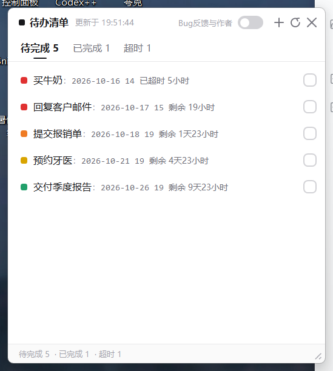
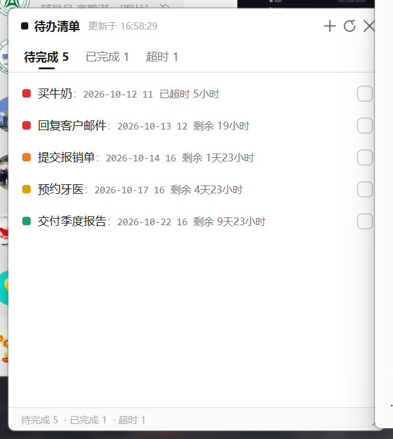
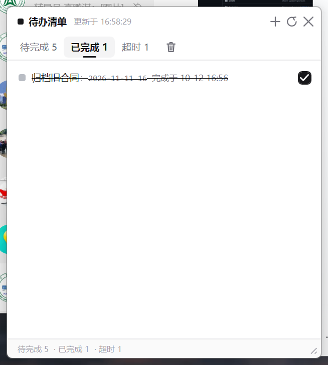
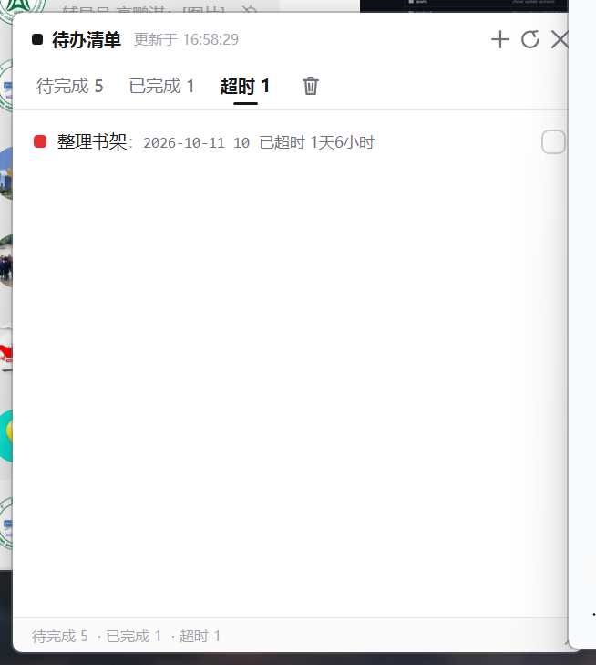
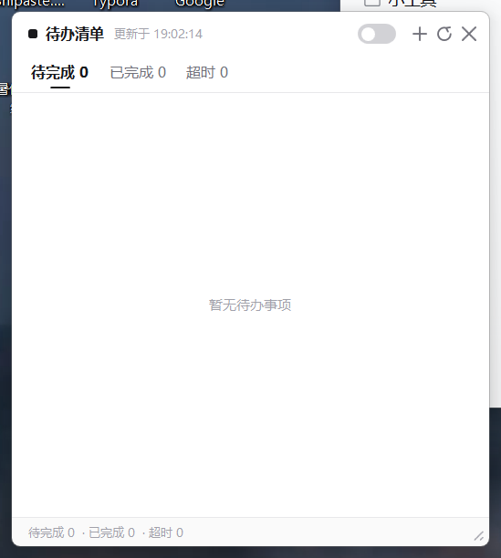
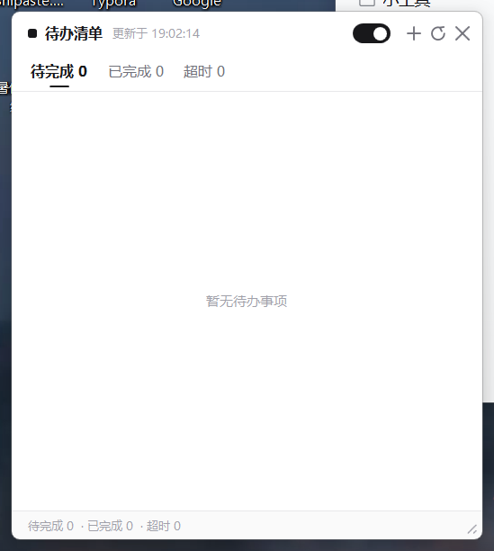
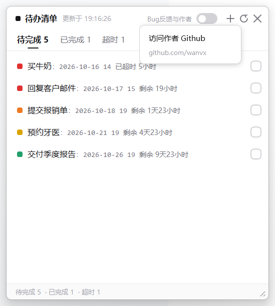

# 待办清单 · 桌面小部件

一个极简的 Windows 桌面待办事项挂件。黑白配色，只有紧急程度用颜色表达。
C# / WPF / .NET 9，**零 NuGet 依赖**，可离线构建。

---

## 快速开始

直接双击：

```
dist\待办清单.exe
```

不需要安装 .NET 运行时（已自包含）。首次运行会在 exe 同目录生成 `data.json` 和 `settings.json`；
如果该目录不可写（例如装在 `Program Files`），会自动改用 `%APPDATA%\TodoWidget\`。

界面上的按钮：

| 位置 | 作用 |
|---|---|
| 标题栏最左的**黑方块** | 点一下把整个界面**收成小标签**，再点一下展开；**按住它拖动可以移动窗口** |
| 标题栏 `Bug反馈与作者` | 灰色小字。点一下弹出小框，再点框里的 `访问作者 Github` 才打开 `github.com/wanvx` |
| 标题栏的**黑白开关** | **锁定 / 解锁**：黑=置顶常驻，白=只贴在桌面（见下文） |
| 标题栏 `＋` | 添加任务 |
| 标题栏 `↻` | 手动刷新（每 30 秒也会自动走时一次） |
| 标题栏 `✕` | 隐藏到系统托盘（**不是退出**） |
| 标签行右侧 `🗑` | 清空当前页面（待完成页不提供，避免误删） |
| 每行悬停时的 `✎` / `🗑` | 编辑 / 删除该条 |
| 每行最右的方框 | 打勾完成；已完成页再点一次可退回待完成 |
| 右下角斜纹 | 拖动改变窗口大小 |
| 标题栏空白处 | 拖动移动窗口（折叠成小标签后，标签空白处同样可以拖） |

**退出程序**：右键系统托盘图标 → `退出`。

---

## 折叠成小标签

点左上角的黑方块，420×470 的完整界面会**瞬时收起**成一个 108×40 的小标签，再点一下展开：

| 展开 | 折叠 |
|---|---|
|  |  |

标签上是 `■ 🟥 待完成 5`：

- **黑方块** —— 点它展开（和收起是同一个控件）
- **第二个方块** —— **最紧急那条待办的颜色**，折叠着也能一眼看出紧不紧急；没有待办时是灰色
- `待完成 N` —— 数量

### 黑方块不会位移

这是刻意设计出来的，不是碰巧：

- 折叠态窗口高度取 **40 = 38（标题栏高度）+ 2（1px 边框 ×2）**，让两种状态下标题栏的**内容高度完全相同**
- 折叠标签的内容是**左对齐 + 10px 左边距**，与展开态标题栏左侧的边距一致

于是黑方块的**点击热区**在两种状态下都是 window-local DIP `(10,10)–(28,28)`，
可见的 8×8 小方块居中落在 DIP `(15,15)–(23,23)`。

**实测验证**（屏幕 125% 缩放，物理像素）：把两种状态截图的同一块按钮区域逐像素比对，
**1517 个像素全部一致，0 个不同**；ASCII 轮廓逐行相同，黑方块都在
window-local 物理 `x=[19..28] y=[20..29]`。

### 同一个方块：点一下折叠，按住拖窗口

黑方块不只是一个按钮，它同时是**拖动把手**：

| 操作 | 结果 |
|---|---|
| 点一下（按下 → 松开，没移动） | 折叠 / 展开 |
| 按住并移动 | **拖动窗口**，松手不会触发折叠 |

判定方式很简单：按下时记住"这次是从方块开始的"，松手时看这期间**有没有真的移动过**
（超过 4px 拖动阈值）。移动过就只当拖动，没移动就当点击。

实测：光标移动 `(150, 80)`，窗口精确移动 `(135, 72)`——正好是扣掉 4px 阈值后剩下的 9 步，
并且**没有误触发折叠**。

> 实现上，黑方块在 XAML 里是 `Border` 而**不是 `Button`**。`Button` 会把
> `MouseLeftButtonDown` 吞掉（自己进入按下态并捕获鼠标），导致"按住方块拖窗口"根本没法实现。
> 换成 `Border` 后，按下事件照常冒泡到标题栏的拖动逻辑，点击与拖动就能用同一套代码分流。
> 代价是方块不能再靠 `Button` 的 `Click` 事件，得自己判断"是点还是拖"。

### 拖动与缩放

- 拖动标题栏 / 小标签的空白处 / **黑方块**都可以移动窗口，都有 4px 阈值，纯点击不会让窗口漂移。
- 右下角斜纹缩放：**窗口尺寸与光标位移严格 1:1**（实测比例 1.000）。
- **碰到最小尺寸后不会"粘住"。** 缩放始终以「按下的那一刻」为锚点，中途绝不重新锚定。
  早先的写法每帧重新锚定，一旦被最小尺寸夹掉一段位移，那段位移就丢了——
  表现为拖到底再往回拖时窗口不跟手，要空拖一段才动。现在夹住就是夹住，
  光标一越回锚点，窗口立刻精确跟随（实测：−500 夹在 413，−300 仍夹在 413，+300 精确变成 971）。

### 实现上的注意点

- **尺寸下限要先放开再赋尺寸。** 窗口 `MinWidth/MinHeight` 是 330×240；不先置 0，
  WPF 会把折叠尺寸夹到 330×240，窗口根本收不下去。
- **展开尺寸绝不从当前 `Width/Height` 取。** `_expandedWidth/_expandedHeight` 只由
  `RestoreGeometry` 和缩放完成事件维护。早先做动画时曾经从实时尺寸取值，
  结果把过渡中的脏尺寸（实测出现 `404.8×388.8`）当成用户偏好写进了 `settings.json`。
- **折叠状态会记住。** 折叠着退出，下次启动还是小标签。
- **点不到时的退路。** 小标签如果被别的窗口盖住就点不到了，所以**托盘菜单里有同样的
  `折叠为小标签` 勾选项**，两边状态同步。

> 曾经试过加折叠动画（190/220ms 缓入缓出），但实测踩到 WPF 两个坑：
> `DoubleAnimation` 挂在 `Window.Height` 上**完全不生效**（宽度会平滑过渡，高度却一动不动、
> 直到动画结束才瞬间跳到目标值）；改用逐帧驱动后，又会在快速连续切换时出现动画打架、
> 卡在半折叠状态（`135×587`）。权衡后按需求回归**瞬时切换**——更快、更可预测，也没有过渡态。

---

## 打包分发给别人

安装包在 `installer\out\TodoWidget-Setup-1.1.0.exe`（**47 MB，单文件**）。

### 已经发到 GitHub

| | |
|---|---|
| 源码仓库 | https://github.com/wanvx/todo-widget |
| 下载页 | https://github.com/wanvx/todo-widget/releases/latest |

下载页有两个文件：

| 文件 | 大小 | 说明 |
|---|---|---|
| `TodoWidget-Setup-1.1.0.exe` | 47 MB | 安装包，可自定义安装位置 |
| `TodoWidget-1.1.0-portable.exe` | 146 MB | 免安装绿色版，放哪都能跑 |

> **为什么仓库里没有 exe？** 单文件发布后的 `待办清单.exe` 有 **146 MB**，超过 GitHub 单文件
> 100 MB 的硬限制，推不上去；而且往 git 历史里塞几十 MB 的二进制会让每次 clone 都变慢。
> 所以二进制走 **Releases**——这也是 GitHub 官方的二进制分发方式。
>
> **为什么下载文件名是英文？** 中文名在下载链接里会被百分号编码，部分客户端还会解成乱码：
> 实测 GitHub 资产名被截成了 `-Setup-1.1.0.exe`（「待办清单」整个丢了）。所以分发文件名用 ASCII，
> 但**装好之后的程序名、快捷方式、卸载项仍然是中文「待办清单」**。

把它发给朋友，对方 **双击 → 选安装位置 → 安装**，全程简体中文，**不需要管理员权限、不弹 UAC**。

| | |
|---|---|
| 默认安装位置 | `C:\代办事情清单`（向导里可改成任意目录） |
| 桌面快捷方式 | 默认勾选，可取消 |
| 开始菜单 | `待办清单` 组，含程序和卸载入口 |
| 安装完成后 | 自动启动小部件 |
| 卸载 | 开始菜单 → `卸载 待办清单`，或「设置 → 应用」 |
| 卸载时的数据 | 会问一句要不要连 `data.json`/`settings.json` 一起删；静默卸载默认**保留** |

重新构建：

```powershell
powershell -NoProfile -ExecutionPolicy Bypass -File tools\build-installer.ps1
```

脚本先发布主程序、再编译安装包。**不需要你预先安装 Inno Setup**：找不到 `ISCC.exe` 时
会自动从官方 GitHub Release 取一份便携版解压到 `%TEMP%`、校验 Authenticode 签名后使用，
不在系统里留任何注册表项或 Program Files 目录。另外 Inno Setup 官方**不带简体中文**
（只有日韩泰等），脚本会自动补齐官方仓库里的语言文件。

### 几个刻意的决定

- **`PrivilegesRequired=lowest`，不弹 UAC。** 实测非管理员账号也能在 `C:\` 根目录建文件夹
  （默认 ACL 给 `Users`「创建文件夹」权限，创建者成为 owner 从而拿到完全控制），
  所以默认路径普通权限就能装成功。若用户自行改成 `Program Files` 这类受保护目录，
  Inno 会直接报权限错误，不会静默装一半。
- **显式给安装目录授 `Users` 修改权限。** 小部件要往自己旁边写 `data.json`。万一目录是
  上一次被提权安装留下的（owner 是 `Administrators`），普通权限运行的程序就会被挡在外面、
  静默退回 `%APPDATA%\TodoWidget`，数据位置就分叉了。
- **`AppMutex` + `CloseApplications`。** 主程序是常驻托盘的小部件，安装/卸载前需要能先把它
  关掉，否则 exe 被占用会导致覆盖失败。
- **卸载询问用 `SuppressibleMsgBox` 而非 `MsgBox`。** 后者在 `/VERYSILENT` 静默卸载时照样
  弹窗并卡住无人值守流程；前者会直接返回默认按钮（默认选「否」，即保留数据）。
- **`AppId` 写死成固定 GUID。** 它决定"这是同一个软件"，将来发新版本时能正确覆盖升级而不是装出两份。

### 关于 SmartScreen

安装包**没有代码签名**，所以朋友第一次运行时 Windows 会弹「Windows 已保护你的电脑」。
点 **更多信息 → 仍要运行** 即可。

要彻底消除这个提示只能购买代码签名证书（每年几百到上千元），对个人小工具通常不划算。

---

## 锁定 / 解锁开关

标题栏右上角有一个黑白开关（托盘菜单里也有对应的 `锁定到最顶层` 勾选项，两边状态同步）：

| 状态 | 外观 | 行为 |
|---|---|---|
| **解锁** | 白底 + 细边框，圆点在左 | 与默认一致：只贴在桌面，被其他窗口遮挡 |
| **锁定** | 纯黑，圆点在右 | 窗口 `Topmost`，固定在最顶层，任何窗口都盖不住 |

状态存在 `settings.json` 的 `Locked` 字段，重启后保持。

**注意**：解锁后窗口会沉到其他窗口下面，如果它被一个最大化窗口盖住，你就**点不到这个开关了**——
这时用**托盘菜单 → `锁定到最顶层`** 把它拉回来（这也是我把它同步到托盘的原因）。
锁定状态优先级高于「桌面停靠方式」：锁定期间切换停靠模式不会立刻生效，解锁后才应用。

> **一个渲染坑**：开关最初是"白色轨道 + 1.2px 细边框"，`CornerRadius=9` 正好等于高度 18 的一半，
> 也就是标准胶囊形——WPF 会把这种细边框渲染成**虚线环**。白色态下它只是一圈淡淡的点，
> 但黑色态下虚线的缝隙会露出白色窗口背景，看起来像一圈"白色痕迹"。
> 现在轨道改成纯色填充、完全不用 Border，黑态就只剩一个干净的白色圆点。
> （同样带边框的打勾框没这个问题，因为它的 `CornerRadius=5` 不是半个高度。）

---

## 紧急程度规则

| 方块颜色 | 条件 |
|---|---|
| 🟩 绿 | 剩余 > 7 天 |
| 🟨 黄 | 3 天 < 剩余 ≤ 7 天 |
| 🟧 橙 | 36 小时 < 剩余 ≤ 3 天 |
| 🟥 红 | 剩余 ≤ 36 小时，**以及已经超时但未满 24 小时** |

## 三个页面

- **待完成**：未完成、且超时未满 24 小时的任务。超时后在原地变红并显示「已超时 X小时」。
- **超时**：超时满 24 小时后自动移入（30 秒内的走时会完成这次移动）。
- **已完成**：打勾后立即移入。

页面归属是**每次刷新时根据当前时间实时算出来的**，不存进文件，所以数据永远不会和时钟不一致。

---

## 桌面停靠方式

托盘右键 → `桌面停靠方式`：

| 模式 | 行为 |
|---|---|
| **贴底小部件（默认，推荐）** | 永远待在 Z 序最底层，被所有窗口遮挡；不出现在任务栏和 Alt+Tab；**实测可用** |
| 真·桌面层（壁纸层） | 用经典 WorkerW 技巧挂到桌面图标后面的壁纸层（Rainmeter 那种）。**取决于系统桌面结构**，挂载失败会自动回退到贴底模式并弹托盘提示 |
| 普通窗口 | 一个普通的无边框窗口，可被覆盖也可被正常激活 |

### 关于「真·桌面层」的实测结论

在本机（Windows 11 Build 26200 + 已安装 WPS 桌面助手）上，explorer 的 13 个 `WorkerW`
窗口**全部处于不可见状态**，且 `wpscloudsvr` 已占用一个可见 WorkerW，
经典算法找不到可挂载的目标，因此该模式在本机**会回退到贴底小部件**。

我也试过把窗口 `SetParent` 到 `Progman` 作为兜底，实测结果是
**窗口进程存活、但永远不可见**——这种失败模式很危险，所以已从代码中移除；
现在挂载失败只会安全降级，绝不会出现"程序在跑但看不见"的情况。

---

## 开机自启动

托盘右键 → 勾选 `开机自启动`。

实现方式是写注册表 `HKCU\Software\Microsoft\Windows\CurrentVersion\Run` 下的 `TodoWidget` 值，
**不需要管理员权限**。程序每次启动会把这个值校正成当前 exe 的路径，所以你移动 exe 之后自启依然有效。

---

## 数据文件

| 文件 | 位置 | 内容 |
|---|---|---|
| `data.json` | exe 同目录（不可写则 `%APPDATA%\TodoWidget\`） | 任务列表 |
| `settings.json` | 同上 | 窗口位置尺寸、停靠模式、自启与提醒开关 |

写入是原子的（先写 `.tmp` 再替换），中途崩溃不会截断你的列表。
如果 `data.json` 损坏，程序会把它备份成 `data.json.corrupt-<时间戳>` 后以空列表启动，而不是静默覆盖。

托盘菜单里的 `打开数据文件夹` 可以直接定位到这两个文件。

---

## 从源码构建

```powershell
# 调试运行
dotnet build src\TodoWidget\TodoWidget.csproj -c Debug
src\TodoWidget\bin\Debug\net9.0-windows\TodoWidget.exe

# 发布单文件 exe 到 dist\
powershell -NoProfile -ExecutionPolicy Bypass -File tools\build.ps1
```

### 打包方式的取舍（实测数据）

在 Windows 11 Build 26200 / 150% 缩放下实测：

| 发布配置 | exe | 工作集 | 私有内存 |
|---|---|---|---|
| 压缩 + ReadyToRun | 69.6 MB | 280 MB | 264 MB |
| 不压缩 + ReadyToRun | 162.4 MB | 165 MB | 147 MB |
| **不压缩 + 无 ReadyToRun（当前）** | **145.1 MB** | **154 MB** | **144 MB** |

`EnableCompressionInSingleFile` 会把程序集解压到**私有内存**里，为此多花 115 MB RAM——
对一个整天常驻的桌面挂件来说，磁盘体积远不如内存重要，所以关掉了压缩。

空闲开销实测：**25 秒内 CPU 占用 0.687% 单核**（32 核机器上 0.02%），线程 21 个，
内存稳定不增长（30 秒定时器只做一次 `DateTime.Now` 与列表比对）。

> 如果想进一步压低内存，下一个可动的杠杆是去掉 `System.Windows.Forms.NotifyIcon`，
> 改用纯 Win32 的 `Shell_NotifyIcon` + WPF 自绘托盘菜单，预计能再省几十 MB。

---

## 验证情况

已经实机验证过的（发布版 exe，非调试版）：

- 待完成 / 已完成 / 超时 三个页面切换与计数
- 打勾 → 立即移入已完成；已完成页取消勾选 → 退回待完成
- 四级颜色阈值（`已超时 5小时` 红 / `剩余 19小时` 红 / `剩余 1天23小时` 橙 / `剩余 4天23小时` 黄 / `剩余 9天23小时` 绿）
- 超时满 24 小时移入超时页
- 添加任务对话框（日期选择器 + 小时下拉 + 中文输入 + Enter 保存）
- 已完成后剩余时间改为「完成于 MM-dd HH:mm」
- 窗口拖动、右下角缩放、位置尺寸持久化、多显示器越界回退
- 贴底模式下被其他窗口完全遮挡（截图为证）
- 开机自启：故意在注册表里写入一个错误路径，程序启动后自动校正成真实路径
- `data.json` 损坏时备份为 `.corrupt-<时间戳>` 并以空列表启动，不崩溃、不静默覆盖

锁定开关的实测（`GetWindowLong(GWL_EXSTYLE)` 读 `WS_EX_TOPMOST`）：

| 场景 | exStyle | TOPMOST | settings.json |
|---|---|---|---|
| 以 `Locked: true` 启动 | `0x00000088` | **True** | — |
| 解锁状态启动 | `0x00000080` | False | — |
| 点一下开关 | `0x00000088` | **True** | `"Locked": true` |
| 再点一下 | `0x00000080` | False | `"Locked": false` |

锁定态下窗口确实盖在最大化的浏览器之上（截图为证）。

> 一个坑：WPF 在窗口显示过程中会重新应用一次自己的 z 序，把 `SourceInitialized`
> 阶段设置的 `Topmost` 悄悄抹掉。所以锁定状态在 `Loaded` 时会再落实一次
> （见 `DesktopDock.SetLocked` 的注释），否则**启动时锁定不生效**。

**未能验证的**：真·桌面层（壁纸层）挂载在本机不可用，原因见上文；
代码保留了该模式并在失败时安全回退，但在这台机器上只会走回退分支。

实测的拖动 / 缩放行为：

- 点击标题栏**不会**让窗口偏移（有 4px 拖动阈值，超过才开始移动）
- 拖动标题栏平移窗口，位移量与鼠标一致（实测 +240,+120 → 窗口 +218,+110，差值即阈值）
- 右下角斜纹拖动缩放（实测 630×705 → 728×806 物理像素）
- 位置和尺寸写入 `settings.json`，重启后恢复；落在已断开的显示器上时自动回落到主屏右下角

### 附带的验证脚本

`tools\` 下除了 `build.ps1` 和 `seed-demo.ps1`，还有三个我在开发中用来做
DPI 感知截图 / 注入鼠标键盘 / 驱动界面的脚本（`capture.ps1`、`ui.ps1`、`type.ps1`）。
它们只是测试工具，不影响程序运行，不需要可以整个删掉。

```powershell
# 灌一份四级颜色 + 已完成 + 已超时的演示数据
powershell -NoProfile -ExecutionPolicy Bypass -File tools\seed-demo.ps1 -Target dist
```

---

## 界面

| 待完成 | 已完成 | 超时 |
|---|---|---|
|  |  |  |

锁定开关的两种状态（右上角）：

| 解锁（白，贴在桌面） | 锁定（黑，置顶常驻） |
|---|---|
|  |  |

作者入口（`Bug反馈与作者` → 弹出小框 → `访问作者 Github`）：



> 刻意做成**两步**：标题栏上那行小字只负责弹框，不会一点就直接拉起浏览器，
> 避免误触把正在全屏的东西顶掉。框里的地址写成灰色小字，点之前就知道会去哪。

> **以后要换链接，只改一处**：`ViewModels/MainViewModel.cs` 里的
> `AuthorHomepageUrl` 常量。弹框里显示的地址由它自动推导，不会出现"链接换了、提示文字忘了改"的情况。
> 想从个人主页改成仓库的 Issues 页，把它换成 `https://github.com/wanvx/<仓库>/issues` 即可。
>
> 当前指向 `https://github.com/wanvx`（个人主页 Overview）。实测 HTTP 200、无重定向。
> 注意这个账号目前**只有 1 个公开仓库 `mayuan_homework`**，跟本工具无关——
> 所以按钮上的"Bug反馈"暂时还没有真正的落点，等建好仓库再换地址。

---

## 工程结构

```
src/TodoWidget/
├── App.xaml(.cs)              应用入口、单实例互斥、托盘接线
├── Models/
│   ├── TodoTask.cs            任务模型（页面归属不落盘）
│   └── Urgency.cs             四级阈值 + 超时 24h 规则 + 剩余时间文案
├── Services/
│   ├── AppPaths.cs            可写目录解析（便携优先，%APPDATA% 兜底）
│   ├── AppSettings.cs         用户偏好
│   ├── TaskStore.cs           原子 JSON 读写
│   ├── AutoStartService.cs    HKCU Run 注册表自启
│   ├── DesktopDock.cs         无边框/托盘隐藏/Z 序/WorkerW 挂载
│   └── TrayService.cs         托盘图标与菜单（运行时绘制图标，无二进制资源）
├── ViewModels/                手写 MVVM（不引 NuGet）
├── Views/                     MainWindow / TaskEditWindow / ConfirmWindow
├── Converters/                可见性、删除线
├── Interop/NativeMethods.cs   Win32 互操作
└── Resources/Theme.xaml       全部配色与控件模板
```

### 关于依赖

刻意没有使用 `CommunityToolkit.Mvvm` 或 `H.NotifyIcon`：
`INotifyPropertyChanged` / `RelayCommand` 一共几十行，手写换来的是**完全离线可构建**；
托盘图标用 `System.Windows.Forms.NotifyIcon`（随 Windows Desktop SDK 提供），
图标是运行时用 GDI+ 画出来的黑底白勾，因此仓库里没有任何二进制资源。

`UseWindowsForms=true` 会让 SDK 注入 `global using System.Windows.Forms;`，
与 WPF 的 `Application` / `MessageBox` 等类型冲突，所以 csproj 里用
`<Using Remove="..."/>` 把它们去掉了，只在托盘服务里显式引入。

---

## 已知取舍

- **截止时间只精确到小时**（按需求）。因此同一小时内无法区分先后，「不足 36 小时」的判定以整小时计算。
- 默认窗口 420×470 DIP，最小 330×240。
- 自启、托盘气泡、编辑任务、30 秒自动走时均可在设置/托盘中控制。
- 任务行按需求是**单行**：`■ 任务：2026-10-12 11  已超时 5小时  ☐`；窗口过窄时任务名会省略号截断，时间与勾选框始终可见。
- 锁定开关是**瞬时切换**（没有滑动动画），与整体的极简取向一致，也省掉了 WPF 动画的开销。
